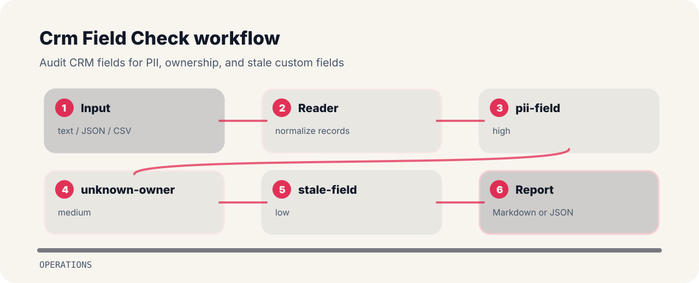

# Crm Field Check


Audit CRM fields for PII, ownership, and stale custom fields.

## Before the fix

```text
risky: field personal_email pii true owner unknown last_used 2023
clean: field plan_name pii false owner salesops last_used 2026
```

## Checks in plain language

| Signal | Level | What it flags | Fix direction |
| --- | --- | --- | --- |
| `pii-field` | high | PII field detected | review access and retention |
| `unknown-owner` | medium | field owner missing | assign owner |
| `stale-field` | low | field may be stale | archive or confirm need |

## How the check reads



## Local check

```bash
git clone https://github.com/mertefekurt/crm-field-check.git
cd crm-field-check
python -m pip install -e ".[dev]"
crm-field-check examples/sample.txt
```
